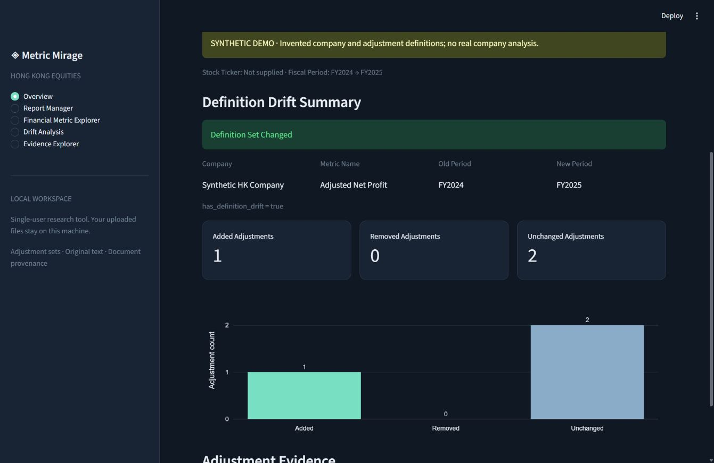
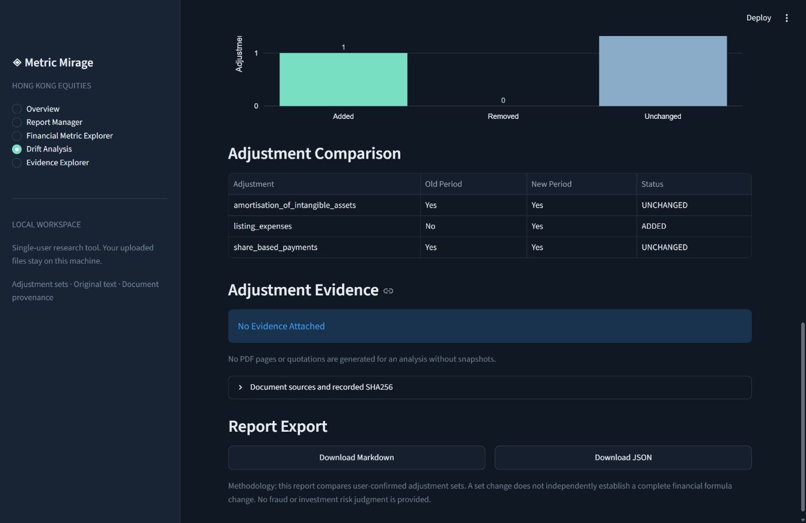
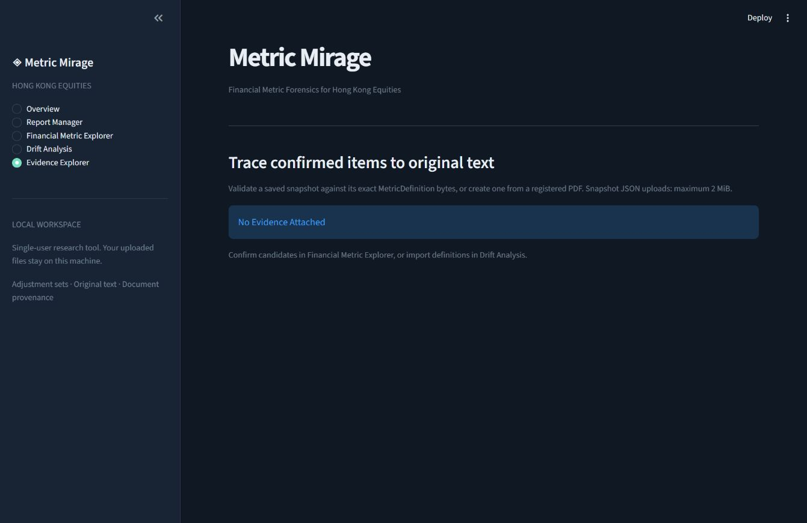

# Metric Mirage

[English](#english) | [繁體中文](#traditional-chinese) | [简体中文](#simplified-chinese)

<a id="english"></a>

**Financial Metric Forensics for Hong Kong Equities**

Track how financial metric definitions evolve across reporting periods, with source-grounded evidence from corporate disclosures.



*Actual dashboard: the SYNTHETIC demo produces 1 added, 0 removed, and 2 unchanged adjustments.*

## Project Introduction

Metric Mirage is a local research tool for examining the adjustment items users confirm from Hong Kong listed-company disclosures. Register a PDF, inspect its extracted text, review conservative Adjusted Net Profit candidates, explicitly select adjustments, and compare the resulting definitions across periods. Optional evidence snapshots retain original excerpts, PDF page positions, and file hashes.

The comparison describes changes in user-confirmed adjustment sets. It does not independently establish that a company's complete financial calculation formula changed.

## Key Features

- Five-page Streamlit dashboard with Plotly charts and a ready-to-use **SYNTHETIC** demo.
- Hong Kong stock code normalization and a local PDF registry with SHA256 identifiers.
- Literal English, Traditional Chinese, and Simplified Chinese search in extractable PDF text.
- Rule-based Adjusted Net Profit candidates, explicit confirmation, and compatible definition JSON exports.
- Deterministic adjustment-set comparisons with Markdown and JSON reports.
- Optional validated evidence snapshots with original text and PDF page positions.
- Python APIs and a command-line interface using the same analysis functions as the dashboard.

## How It Works

1. **Register** a local PDF you have the right to process, with its stock code, company, period, report type, and source description.
2. **Inspect** keyword matches and adjustment candidates with their original evidence.
3. **Confirm** the specific candidates you intend to retain; selection starts empty.
4. **Compare** two saved definitions to find added, removed, and unchanged adjustments.
5. **Trace** the comparison to captured evidence snapshots when both periods' snapshots are available.

Registration supports `annual`, `interim`, `annual_results`, and `interim_results`. Codes such as `700`, `0700.HK`, and `00700` normalize to `00700`; formatting validation does not verify a listing.

## Real Report Case

The [Xiaomi FY2023-FY2024 case study](docs/cases/xiaomi-2023-2024/README.md) follows two official English annual reports through source review, candidate extraction, explicit selection, evidence snapshots, and comparison. It includes frozen AI-assisted labels, results before and after a narrow parser correction, missed items, and reproduction instructions. The selected adjustment sets have no additions or removals; this does not establish that the complete financial formulas are identical.

The case is a development example with a separate AI verification pass, not an independent human benchmark. Human review time was not measured. Source PDFs and the private registry stay outside Git; the case links to the official documents and records their hashes.

## Quick Start

Requires **Python 3.11+**. From a source checkout, with your Python environment activated:

```sh
python -m pip install -e .
python -m streamlit run app.py
```

Open the local URL printed by Streamlit, normally `http://localhost:8501`. On **Overview**, select **Explore Demo**. No financial report, API key, or external service configuration is needed to run the bundled demo after installation.

Prefer the terminal? Run the separate synthetic Adjusted EBITDA example:

```sh
python -m metric_mirage demo
```

## Dashboard

| Page | Purpose |
| --- | --- |
| Overview | Current analysis, adjustment counts, a comparison chart, and Explore Demo. |
| Report Manager | Upload and register a PDF; inspect its metadata and SHA256. |
| Financial Metric Explorer | Search PDF text, inspect candidates, select adjustments, and download a confirmed definition. |
| Drift Analysis | Choose saved definitions or upload JSON; compare periods and download Markdown or JSON, with optional paired evidence. |
| Evidence Explorer | Create or load a definition's snapshot and inspect original excerpts, PDF pages, and hashes. |

Results remain available across page navigation in the current session. Changing the relevant report or input clears results that no longer apply. The interface distinguishes **Evidence Available**, **No Evidence Attached**, and **Evidence Validation Failed**.

Uploads and exports are stored under the Git-ignored `.metric_mirage/` directory: `uploads/`, `definitions/`, `evidence/`, and the `reports.json` registry. PDF uploads are limited to **25 MiB**; JSON uploads to **2 MiB**. Generated storage names prevent uploaded filenames from becoming filesystem paths. Existing output files are not overwritten.

The dashboard is intended for **local, single-user use**. It has no authentication or tenant isolation. The supplied Streamlit configuration binds the server to `127.0.0.1`; keep it on a trusted local interface. It is not configured as a public multi-user service. A trusted operator can set `METRIC_MIRAGE_DATA_DIR` before startup to change the storage directory. Supply that directory's registry path explicitly when using the CLI.

## Demo Walkthrough

1. Select **Explore Demo** on Overview.
2. Inspect the **SYNTHETIC** Adjusted Net Profit definitions for FY2024 and FY2025.
3. FY2024 includes `share_based_payments` and `amortisation_of_intangible_assets`. FY2025 also includes `listing_expenses`.
4. The existing comparison engine returns **1 added, 0 removed, and 2 unchanged** adjustments.
5. Open **Drift Analysis** to inspect the table and download Markdown or JSON.

All demo company details and definitions are invented. The demo shows **No Evidence Attached** and supplies no invented quotations, PDF pages, or real-company results. The CLI demo uses the separately bundled synthetic Adjusted EBITDA definitions.

## Financial Definition Drift

A definition JSON uses the existing five fields:

```json
{
  "company": "Synthetic HK Company",
  "metric_name": "Adjusted Net Profit",
  "fiscal_period": "FY2024",
  "adjustments": ["share_based_payments", "amortisation_of_intangible_assets"],
  "source": "SYNTHETIC: invented definition; no report evidence attached."
}
```

In Drift Analysis, choose the older definition first. Drift reports require exact periods such as `FY2024` and `FY2025`, with the new year later than the old year, and compatible company and metric names. The general `compare` command also accepts other period labels.

This **SYNTHETIC** table illustrates the dashboard demo:

| Adjustment | Old Period | New Period | Status |
| --- | --- | --- | --- |
| amortisation_of_intangible_assets | Yes | Yes | UNCHANGED |
| listing_expenses | No | Yes | ADDED |
| share_based_payments | Yes | Yes | UNCHANGED |

`has_definition_drift` is `true` when the normalized added or removed set is nonempty. Names receive basic whitespace normalization and Unicode case folding; synonyms are not inferred. Lists and tables use stable sorting. Reports preserve both full `source` strings and remain usable without attached evidence.



*Actual dashboard: the demo comparison has No Evidence Attached and remains downloadable as Markdown or JSON.*

## Evidence Traceability

Confirmation includes the registered source description and PDF SHA256 in the definition's `source`. Evidence export rechecks the current PDF hash, extracts original candidate evidence for every selected item, and binds the snapshot to the **exact definition-file bytes** through a separate SHA256. A formatting-only edit to definition JSON therefore invalidates its snapshot association.

Create a snapshot in Evidence Explorer, or upload one alongside its associated definition. Validation checks the schema, hashes, company, period, metric, source, and confirmed adjustment set. Evidence-backed drift requires valid snapshots for both periods. The viewer preserves matched text and original excerpts; page numbers start at **1** and refer to the PDF's page positions, which may differ from printed page labels.

SHA256 provides content identity and consistency checks, **not a digital signature or proof of publisher authenticity**. Drift reads captured snapshots rather than reopening the PDFs. An item absent from a user's confirmed set does not establish that it was absent from the original report.



*Actual dashboard: an empty workspace shows No Evidence Attached; no quotations or PDF pages are invented.*

## CLI Usage

The bundled comparison can be run immediately from the checkout:

```sh
python -m metric_mirage demo
python -m metric_mirage compare examples/old.json examples/new.json
python -m metric_mirage compare examples/old.json examples/new.json --format json
```

The following workflow requires your own local PDF and metadata. Replace `report_2024.pdf`, the company, code, and source description with values for a report you may process:

```sh
python -m metric_mirage reports add report_2024.pdf --ticker 0700 --company "Your company" --type annual --period FY2024 --source "Issuer IR"
python -m metric_mirage reports list 00700 --format json
python -m metric_mirage reports search 00700 --period FY2024 --keyword "經調整淨利潤" --max-results 10
python -m metric_mirage reports candidates 00700 --period FY2024 --format json
```

After reviewing the candidates, explicitly select names that actually appear in that report:

```sh
python -m metric_mirage reports confirm 00700 --period FY2024 --select share_based_payments --select amortisation_of_intangible_assets --output definition_2024.json
python -m metric_mirage reports evidence 00700 --period FY2024 --definition definition_2024.json --output evidence_2024.json
```

Repeat registration, review, confirmation, and optional evidence export for FY2025, then compare:

```sh
python -m metric_mirage compare definition_2024.json definition_2025.json
python -m metric_mirage drift definition_2024.json definition_2025.json
python -m metric_mirage drift definition_2024.json definition_2025.json --format json
python -m metric_mirage drift definition_2024.json definition_2025.json --old-evidence evidence_2024.json --new-evidence evidence_2025.json
```

Report commands accept `--registry PATH`; search, candidates, confirmation, and evidence also accept `--type` to narrow an ambiguous selection. Multiple matching reports produce an explicit error. Exports require an existing parent directory, a new output filename, and a filesystem supporting hard links; unsupported output volumes fail without leaving a partial final file. CLI registration retains the original PDF path and does not copy or modify the report.

JSON reports contain no extra stdout messages. Expected input errors produce helpful stderr messages and nonzero exit codes. See `python -m metric_mirage --help` and each subcommand's `--help` for options.

The public comparison API remains available independently of the dashboard:

```python
from metric_mirage import MetricDefinition, compare_metrics, normalize_hk_ticker

old = MetricDefinition("Synthetic company", "Adjusted Net Profit", "FY2024",
                       ["share_based_payments"], "SYNTHETIC: old definition")
new = MetricDefinition("Synthetic company", "Adjusted Net Profit", "FY2025",
                       ["share_based_payments", "listing_expenses"],
                       "SYNTHETIC: new definition")
diff = compare_metrics(old, new)
assert diff.added_adjustments == ("listing_expenses",)
assert normalize_hk_ticker("0700.HK") == "00700"
```

## Installation

Create an isolated environment before the Quick Start commands:

```sh
python -m venv .venv
```

Activate it in Windows PowerShell:

```powershell
.\.venv\Scripts\Activate.ps1
```

Or on macOS/Linux:

```sh
source .venv/bin/activate
```

Then run `python -m pip install -e .` from the project root. Declared runtime dependencies are `pypdf`, Streamlit, and Plotly. No API key is needed. The root `app.py` is the source-checkout dashboard launcher; installed package APIs and the CLI are also usable outside the checkout.

For the documented real-report case, install the optional PDF font support used by those reports:

```sh
python -m pip install -e ".[research]"
```

For development and local distribution builds:

```sh
python -m pip install -e ".[dev]"
python -m build
```

## Testing

```sh
python -m unittest discover -s tests -v
```

Tests use temporary directories, synthetic JSON/PDF inputs, and mocked page text where appropriate. They cover the core APIs, CLI, report registration, search, candidates, explicit confirmation, file safety, evidence association, Markdown/JSON exports, and Streamlit integration with `AppTest`. Financial APIs, real reports, API keys, and paid services are not required.

The [GitHub Actions workflow](.github/workflows/ci.yml) is configured for Ubuntu with Python **3.11, 3.12, and 3.13**, including tests, package builds, CLI Demo, and Streamlit imports. Hosted results must be checked in GitHub Actions after publication; local checks do not establish a successful cloud run.

See [CONTRIBUTING.md](CONTRIBUTING.md) for development guidance and [SECURITY.md](SECURITY.md) for vulnerability reporting and deployment boundaries.

## Methodology

Candidate extraction currently supports **Adjusted Net Profit**, including its explicit English, Traditional Chinese, and Simplified Chinese metric aliases. It uses a small dictionary and conservative, limited same-page context to identify adjustment relationships. Supported canonical items are:

- `share_based_payments`
- `fair_value_changes`
- `impairment_losses`
- `listing_expenses`
- `acquisition_related_expenses`
- `amortisation_of_intangible_assets`

Candidates remain separate from definitions until a user explicitly selects them. Comparison applies set differences to normalized adjustment names and does not recalculate financial values. Evidence preserves extracted text rather than paraphrasing it. A reported set change is neither a complete formula audit nor a financial-fraud or investment-risk assessment.

## Limitations

- PDF text extraction depends on text layers and font encoding. Scanned documents and some Chinese fonts may not produce usable text; there is no OCR.
- Conservative candidate rules can miss valid wording, tables, and relationships spanning pages. An empty candidate list means no supported relationship was established, not that the metric has no adjustments.
- User selections may be incomplete. Missing selected items do not prove missing disclosure, and set changes do not independently prove changes in a complete financial formula.
- Snapshots are local captured evidence, not signed authenticity proofs or live-PDF verification.
- The dashboard is a local single-user tool with no authentication or tenant isolation. Do not treat it as a public multi-user deployment.
- Only local reports supplied under the user's processing rights are supported; reports are not automatically downloaded.
- Real-report evaluation is limited to the [Xiaomi FY2023-FY2024 development case](docs/cases/xiaomi-2023-2024/README.md), using AI-assisted labels and a separate AI verification pass. It is not an independent human benchmark or evidence of general accuracy. The bundled demo and offline test fixtures remain synthetic.

## License

Metric Mirage is available under the [MIT License](LICENSE).

---

<a id="traditional-chinese"></a>

## 繁體中文

### 專案簡介

Metric Mirage 是面向香港股票市場的本地財務指標口徑研究工具。你可以登記自己的財報 PDF、搜尋原文、檢視「經調整淨利潤」（Adjusted Net Profit）附近的調整候選項目，再明確選取要保留的項目，匯出指標定義並比較不同報告期間的新增、移除及保留項目。選用的證據快照可保留原文片段、PDF 頁碼及檔案雜湊，方便追溯來源。

### 入口與快速開始

本 GitHub 頁面提供原始碼與使用文件；Dashboard 在你的電腦本地執行。需要 **Python 3.11 或以上版本**。

1. 下載專案並建立虛擬環境：

   ```sh
   git clone https://github.com/AndyLamyinwik/metric-mirage.git
   cd metric-mirage
   python -m venv .venv
   ```

2. 啟用虛擬環境。Windows PowerShell 使用：

   ```powershell
   .\.venv\Scripts\Activate.ps1
   ```

   macOS／Linux 使用：

   ```sh
   source .venv/bin/activate
   ```

3. 安裝並啟動 Dashboard：

   ```sh
   python -m pip install -e .
   python -m streamlit run app.py
   ```

4. 在瀏覽器開啟終端顯示的本地網址，通常是 **http://localhost:8501**。在 **Overview** 頁面按 **Explore Demo**，即可體驗標示為 **SYNTHETIC（合成資料）** 的比較範例。安裝完成後，示範不需要財報檔案或 API Key。

### 如何使用

介面目前使用英文，主要入口如下：

| 頁面 | 用途 |
| --- | --- |
| Overview | 查看比較摘要、圖表，或開啟合成示範。 |
| Report Manager | 上傳並登記你有權處理的 PDF，填寫股票代碼、公司、期間與來源。 |
| Financial Metric Explorer | 搜尋原文、檢視調整候選項目，明確選取後下載已確認的指標定義 JSON。 |
| Drift Analysis | 載入舊、新兩期定義，比較調整項目並下載 Markdown 或 JSON 報告。 |
| Evidence Explorer | 建立或載入證據快照，檢視原文、PDF 頁碼及檔案雜湊。 |

也可以在專案目錄使用命令列：

```sh
python -m metric_mirage demo
python -m metric_mirage compare examples/old.json examples/new.json
python -m metric_mirage drift definition_2024.json definition_2025.json
```

前兩個指令使用內附的合成資料；最後一個需要先準備你自己確認並匯出的兩期定義 JSON。完整報告登記、搜尋、確認及證據指令請見上方 [CLI Usage](#cli-usage)。

### 方法與限制

候選項目由保守規則提取，必須由使用者主動選取；比較結果僅描述已確認調整項目集合的變化，不能獨立證實完整財務公式已改變，也不提供財務舞弊或投資風險判斷。PDF 需有可提取的文字層，部分中文字型可能無法正確讀取；目前沒有 OCR。Dashboard 適用於本地單使用者操作，沒有登入驗證或多租戶隔離。內附示範及離線測試仍使用合成資料。專案採用 [MIT 授權](LICENSE)。

真實報告驗證請見[小米 FY2023-FY2024 案例](docs/cases/xiaomi-2023-2024/README.md)，包含官方來源、原文頁碼、候選與確認結果、漏抓項目、評估表及重現步驟。此為 AI 輔助標註及另一輪 AI 核對的開發案例，未經獨立真人基準驗證，亦未量測真人覆核時間；結果不能推廣為一般準確率。兩期已選取集合沒有新增或移除項目。執行案例前請依案例文件安裝 `python -m pip install -e ".[research]"`，啟用所需的 PDF 字型支援。

---

<a id="simplified-chinese"></a>

## 简体中文

### 项目简介

Metric Mirage 是面向香港股票市场的本地财务指标口径研究工具。你可以登记自己的财报 PDF、搜索原文、查看“经调整净利润”（Adjusted Net Profit）附近的调整候选项目，再明确选择要保留的项目，导出指标定义并比较不同报告期间的新增、移除及保留项目。可选的证据快照能够保留原文片段、PDF 页码及文件哈希，方便追溯来源。

### 入口与快速开始

本 GitHub 页面提供源代码与使用文档；Dashboard 在你的电脑本地运行。需要 **Python 3.11 或以上版本**。

1. 下载项目并创建虚拟环境：

   ```sh
   git clone https://github.com/AndyLamyinwik/metric-mirage.git
   cd metric-mirage
   python -m venv .venv
   ```

2. 激活虚拟环境。Windows PowerShell 使用：

   ```powershell
   .\.venv\Scripts\Activate.ps1
   ```

   macOS／Linux 使用：

   ```sh
   source .venv/bin/activate
   ```

3. 安装并启动 Dashboard：

   ```sh
   python -m pip install -e .
   python -m streamlit run app.py
   ```

4. 在浏览器打开终端显示的本地网址，通常是 **http://localhost:8501**。在 **Overview** 页面点击 **Explore Demo**，即可体验标为 **SYNTHETIC（合成数据）** 的比较示例。安装完成后，演示不需要财报文件或 API Key。

### 如何使用

界面目前使用英文，主要入口如下：

| 页面 | 用途 |
| --- | --- |
| Overview | 查看比较摘要、图表，或打开合成演示。 |
| Report Manager | 上传并登记你有权处理的 PDF，填写股票代码、公司、期间与来源。 |
| Financial Metric Explorer | 搜索原文、查看调整候选项目，明确选择后下载已确认的指标定义 JSON。 |
| Drift Analysis | 载入旧、新两期定义，比较调整项目并下载 Markdown 或 JSON 报告。 |
| Evidence Explorer | 创建或载入证据快照，查看原文、PDF 页码及文件哈希。 |

也可以在项目目录使用命令行：

```sh
python -m metric_mirage demo
python -m metric_mirage compare examples/old.json examples/new.json
python -m metric_mirage drift definition_2024.json definition_2025.json
```

前两个命令使用内附的合成数据；最后一个需要先准备你自己确认并导出的两期定义 JSON。完整报告登记、搜索、确认及证据命令请见上方 [CLI Usage](#cli-usage)。

### 方法与限制

候选项目由保守规则提取，必须由用户主动选择；比较结果仅描述已确认调整项目集合的变化，不能独立证实完整财务公式已改变，也不提供财务舞弊或投资风险判断。PDF 需要可提取的文本层，部分中文字体可能无法正确读取；目前没有 OCR。Dashboard 适用于本地单用户操作，没有登录验证或多租户隔离。内附演示及离线测试仍使用合成数据。项目采用 [MIT 许可证](LICENSE)。

真实报告验证请见[小米 FY2023-FY2024 案例](docs/cases/xiaomi-2023-2024/README.md)，包含官方来源、原文页码、候选与确认结果、漏抓项目、评估表及重现步骤。此为 AI 辅助标注及另一轮 AI 核对的开发案例，未经独立真人基准验证，也未测量真人复核时间；结果不能推广为一般准确率。两期已选取集合没有新增或移除项目。运行案例前请按案例文档安装 `python -m pip install -e ".[research]"`，启用所需的 PDF 字体支持。
